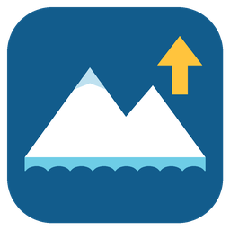
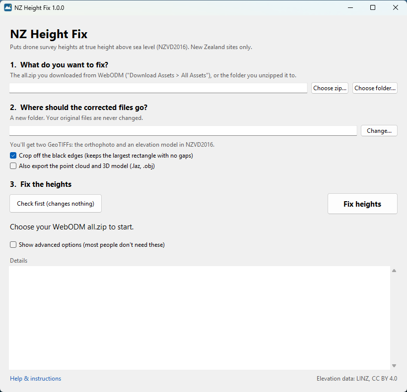

<p align="center"></p>

<h1 align="center">NZ Height Fix</h1>

<p align="center">
Puts your drone maps at the right height above sea level (NZVD2016), automatically.<br>
For WebODM / OpenDroneMap projects in <b>New Zealand</b>.
</p>

<p align="center"></p>

---

## The problem

Ordinary (non-RTK) drones are good at measuring how high they are *above where they took off*, but bad at knowing how high that is above sea level. Their "absolute" altitude is often tens or even hundreds of metres out. So your WebODM elevation models, point clouds and 3D models come out at the wrong height.

NZ Height Fix compares your map with **LINZ's national LiDAR elevation model** (which is in NZVD2016, New Zealand's official height system), works out how far out your heights are, and corrects every output. You don't need to know your takeoff height or have ground control points.

## Download and install

1. Go to the [**Releases**](../../releases/latest) page and download `NZHeightFix-Setup-x.y.z.exe`.
2. Double-click it.
   - If Windows says *"Windows protected your PC"*, click **More info** and then **Run anyway**. This appears because the installer isn't code-signed yet.
3. Click **Next** through the installer. It doesn't need admin rights.

NZ Height Fix then appears in your Start menu. To remove it, go to *Settings > Apps > Installed apps*.

## How to use it

1. In WebODM, open your finished task and click **Download Assets > All Assets**. This gives you `all.zip`.
2. Open **NZ Height Fix**.
3. **Step 1:** click **Choose zip...** and pick that `all.zip`.
4. **Step 2:** the output folder is filled in for you, next to the zip. Change it if you like.
5. **Step 3:** click **Check first** to see how far out the heights are. This changes nothing.
6. Click **Fix heights**. When it's finished, click **Open output folder**.

It needs an internet connection, because it reads the LINZ elevation data for your site. It usually takes a minute or two.

> **Tip:** the result tells you how well your map matched the LINZ data. A spread under about ±1 m is a great match. If it shows a warning about a large spread, look at the result carefully. The ground may have changed since LINZ's survey, for example from earthworks or new buildings, or the model may be tilted.

### What you get

Two GeoTIFFs, ready for QGIS, ArcGIS or CAD:

| File | What it is |
|---|---|
| `<name> - orthophoto.tif` | the orthophoto |
| `<name> - DSM NZVD2016.tif` | the elevation model, with heights in metres above sea level (NZVD2016). If your WebODM task made a DTM (ground only), you get `DTM` instead. If it made no elevation model at all, one is built from the point cloud. |

**Black edges:** WebODM maps have an irregular outline, and the empty area around it shows as black in many programs. By default, both files are cropped to the largest rectangle that has no gaps, so there are no black edges. If your flight was at an angle, that rectangle can be much smaller than the mapped area. Untick **Crop off the black edges** to keep the whole area instead. The edges are then transparent, not cropped.

Tick **Also export the point cloud and 3D model** to get corrected copies of these files too:

| File | Corrected? |
|---|---|
| `odm_georeferencing/odm_georeferenced_model.laz` (point cloud) | ✅ |
| `odm_texturing/odm_textured_model_geo.obj` (3D model, with its textures) | ✅ |
| `odm_dem/dsm.tif`, `odm_dem/dtm.tif` (WebODM's own elevation models, uncropped) | ✅ |
| `.glb` 3D model, web viewer tiles | ❌ Not corrected. Use the `.obj` instead. |

**Your original files are never changed.** The exports keep WebODM's map projection, which is UTM.

## Advanced options

Tick **Show advanced options** in the window for these other methods:

- **GNSS ellipsoid → NZVD2016:** only for RTK/PPK drones whose heights are true GNSS ellipsoidal heights. Subtracts the NZGeoid2016 geoid height.
- **Raw DJI photos: takeoff height + relative altitude:** corrects the photos *before* WebODM. You enter the real ground height where you took off.
- **Fixed offset:** adds or subtracts a number of metres that you choose.

There's also a command-line version: run `NZHeightFix.exe --help` from the install folder.

## FAQ

**My site isn't covered by LINZ LiDAR.** Almost all of New Zealand is covered by the 1 m LiDAR elevation model. Where it isn't, the tool falls back to LINZ's 8 m national elevation model.

**I used ground control points (GCPs) surveyed in NZVD2016.** Then your heights are already right. Don't run this tool on them.

**I need Auckland Vertical Datum 1946 (AVD-46), or another local datum.** That isn't supported. The output is always NZVD2016.

**Does it change horizontal positions?** No. Only heights change.

## Data and credits

- Elevation data: [LINZ](https://www.linz.govt.nz/) NZ elevation models, sourced from the LINZ Data Service and licensed for reuse under [CC BY 4.0](https://creativecommons.org/licenses/by/4.0/).
- NZGeoid2016 grid: LINZ, CC BY 4.0, via the [PROJ data CDN](https://cdn.proj.org/).
- Built with [rasterio](https://rasterio.readthedocs.io/)/GDAL, [pyproj](https://pyproj4.github.io/pyproj/)/PROJ and [laspy](https://laspy.readthedocs.io/).

This is not an official LINZ product. Check your results before relying on them for anything important.

---

## For developers

**Run from source:** double-click `run.bat`. The first time, it downloads [uv](https://github.com/astral-sh/uv) and a private Python 3.13 into `.tools\`. It never uses or changes any Python already on the PC.

**Build the app and installer locally:**

```powershell
powershell -ExecutionPolicy Bypass -File scripts\build.ps1
```

This writes the app to `dist\NZHeightFix\` and, if [Inno Setup 6](https://jrsoftware.org/isinfo.php) is installed, `dist\NZHeightFix-Setup-<version>.exe`.

**Release a new version:**
1. Bump `__version__` in `nz_height_fix.py` and commit.
2. Push a matching tag, e.g. `git tag v1.0.1` then `git push origin v1.0.1`.
3. GitHub Actions builds the installer and publishes it on the Releases page.

Every push to `main` also builds the installer. You can download it from the workflow run's *Artifacts*.

| Path | What it is |
|---|---|
| `nz_height_fix.py` | the whole program: GUI, command line and the correction code |
| `packaging/nz_height_fix.spec` | PyInstaller build definition |
| `packaging/installer.iss` | Inno Setup installer script |
| `packaging/make_icon.py` | draws `icon.ico` / `icon.png` |
| `scripts/build.ps1` | build script, used locally and in CI |
| `.github/workflows/build.yml` | CI build and release |

Licence: [MIT](LICENSE).
